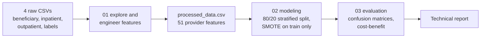

<div align="center">

# Healthcare Provider Fraud Detection

**Flagging potentially fraudulent Medicare providers from 558,211 claims, with a five-model comparison that looks past accuracy.**


[](LICENSE)

</div>

## At a glance

| | |
|---|---|
| **Task** | Classify each of 5,410 providers as fraudulent or not (9.4% are fraudulent) |
| **Data** | Kaggle [Healthcare Provider Fraud Detection](https://www.kaggle.com/datasets/rohitrox/healthcare-provider-fraud-detection-analysis): 138,556 patients, 558,211 claims. Not included in this repo |
| **Features** | 51 provider-level features aggregated from claim and patient data |
| **Models** | Logistic Regression, XGBoost, Random Forest, SVM, Decision Tree |
| **Winner** | Logistic Regression: ROC-AUC 0.9506, catches 88.1% of fraudulent providers (precision 0.43). Chosen for recall and interpretability |
| **Care taken** | SMOTE on the training split only; the test set keeps the natural 9.4% fraud rate |
| **Report** | [`Technical_Report.pdf`](Technical_Report.pdf), with one known number mismatch explained in the [correction note](#correction-note) |


## Contents

[Pipeline](#pipeline) · [Problem and data](#problem--data) · [Methodology](#methodology) · [Results](#results-as-reported-in-technical_reportpdf) · [Correction note](#correction-note) · [Reproducing it](#reproducing-it) · [Limitations](#limitations) · [Layout](#repository-layout)

## Pipeline



## Problem & data

- **Source:** [Healthcare Provider Fraud Detection](https://www.kaggle.com/datasets/rohitrox/healthcare-provider-fraud-detection-analysis) dataset (Kaggle)
- **Scale:** 138,556 patients, 558,211 claims (40,474 inpatient + 517,737 outpatient), 5,410 providers
- **Challenge:** severe class imbalance — only 506 providers (9.4%) are labeled fraudulent (≈9.7:1 ratio)
- **Prediction unit:** the *provider*, not the individual claim — all patient- and claim-level data is aggregated up to 51 provider-level features (financial aggregates, chronic-condition rates, claim-volume statistics, engineered ratios)


## Methodology

1. **`01_data_exploration_and_feature_engineering.ipynb`** — loads and cleans the four raw datasets (beneficiary, inpatient, outpatient, fraud labels), handles missing values, and aggregates everything to 51 provider-level features.
2. **`02_modeling.ipynb`** — 80/20 stratified train/test split, feature scaling, SMOTE applied to the *training set only* (test set kept at the natural 9.4% fraud rate for realistic evaluation), and five models trained: Logistic Regression, Decision Tree, Random Forest, XGBoost, SVM.
3. **`03_evaluation.ipynb`** — confusion matrices, a cost-benefit analysis, and deployment recommendations based on risk tiers.

## Results (as reported in `Technical_Report.pdf`)

| Model | ROC-AUC | Precision | Recall | F1 |
|---|---|---|---|---|
| **Logistic Regression** | **0.9506** | 0.4279 | 0.8812 | 0.5761 |
| XGBoost | 0.9501 | 0.5748 | 0.7228 | 0.6404 |
| Random Forest | 0.9492 | 0.5385 | 0.7624 | 0.6311 |
| SVM | 0.9399 | 0.3974 | 0.9010 | 0.5515 |
| Decision Tree | 0.9023 | 0.4096 | 0.7624 | 0.5329 |

Logistic Regression was selected as the best model — highest ROC-AUC, near-top recall (it catches 88.1% of fraudulent providers in the held-out test set, second only to the SVM's 90.1% at lower precision), and the most interpretable choice for a regulated healthcare context. Confusion matrix on the test set (from `notebooks/03_evaluation.ipynb`): 89 true positives, 862 true negatives, 119 false positives, 12 false negatives.


The top predictive features (Random Forest importance) were dominated by financial aggregates — `total_reimbursed`, `total_inpatient_deductible`, `total_inpatient_reimbursed`, `num_inpatient_claims`, and `inpatient_reimbursement_range` ranked highest. Deceased-patient count (`num_deceased`) is a smaller signal (rank 16 of the top 20).


The report additionally includes a cost-benefit and ROI projection (error costs, investigation-efficiency gains, and a scaled-savings estimate) based on assumed per-case investigation costs — this is a course-project business-case exercise, not a validated real-world deployment figure, and is presented in `Technical_Report.pdf` with its assumptions stated.

## Correction note

`Technical_Report.pdf` (the submitted report) lists the Logistic Regression confusion matrix as 926 true negatives / 55 false positives, and prices false positives at $275K on that basis. The notebook's computed outputs give 862 / 119 (and a $595K false-positive cost at the same $5,000 per case). The notebook numbers are the ones consistent with the reported precision (89 / (89 + 119) = 0.4279) and accuracy (0.8789), so this README uses them. The PDF is kept unmodified as the original submission.

## Reproducing it

The notebooks were written for Google Colab and read and write under `/content/drive/MyDrive/fraud_detection_project/` (`data/`, `results/`). To re-run them:

1. Download the four `Train_*.csv` files from the Kaggle dataset linked above. They are not in this repo.
2. Put them in `fraud_detection_project/data/` on Google Drive (or change `data_path` in notebook 01 for a local run).
3. Run `01`, `02`, `03` in order. Each notebook saves what the next one reads (`processed_data.csv`, `model_comparison.csv`, `predictions.csv`, `feature_importance.csv`).

Libraries used: pandas, numpy, scikit-learn, imbalanced-learn, xgboost, matplotlib, seaborn.

## Limitations

- The cost-benefit figures rest on assumed per-case costs; they are a course business-case exercise, not a validated deployment estimate.
- One train/test split, no cross-validated confidence intervals, so small gaps between models (for example 0.9506 vs 0.9501 ROC-AUC) should not be over-read.
- The data is a public Kaggle dataset, so it says nothing about how the model would behave on a real payer's claims.
- The raw data and the saved intermediate CSVs are not in the repository.

## Repository layout

```text
.
├── notebooks/
│   ├── 01_data_exploration_and_feature_engineering.ipynb
│   ├── 02_modeling.ipynb
│   └── 03_evaluation.ipynb
├── docs/figures/              # figures used in this README
├── Technical_Report.pdf       # the submitted report, unmodified
└── LICENSE
```

## Skills demonstrated

End-to-end ML pipeline design on real-world-scale tabular data, correct handling of class imbalance (SMOTE on training data only, so nothing leaks into evaluation), model comparison beyond accuracy (ROC-AUC and the precision/recall trade-off), and turning model output into a business-facing report with error analysis.

## License

[MIT](LICENSE) © 2026 Abdelrahman Shaheen
