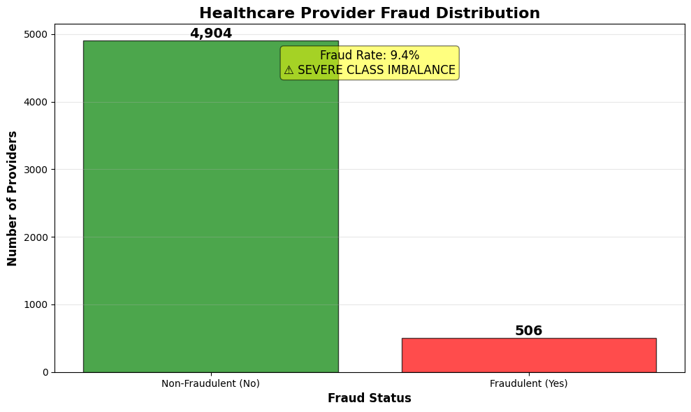
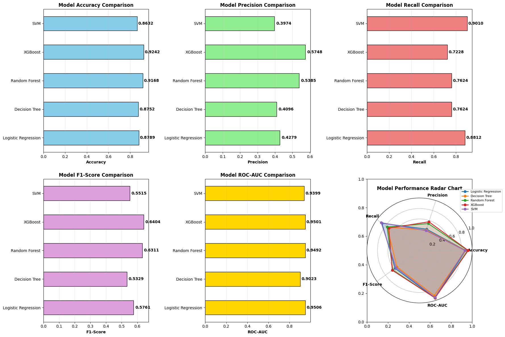
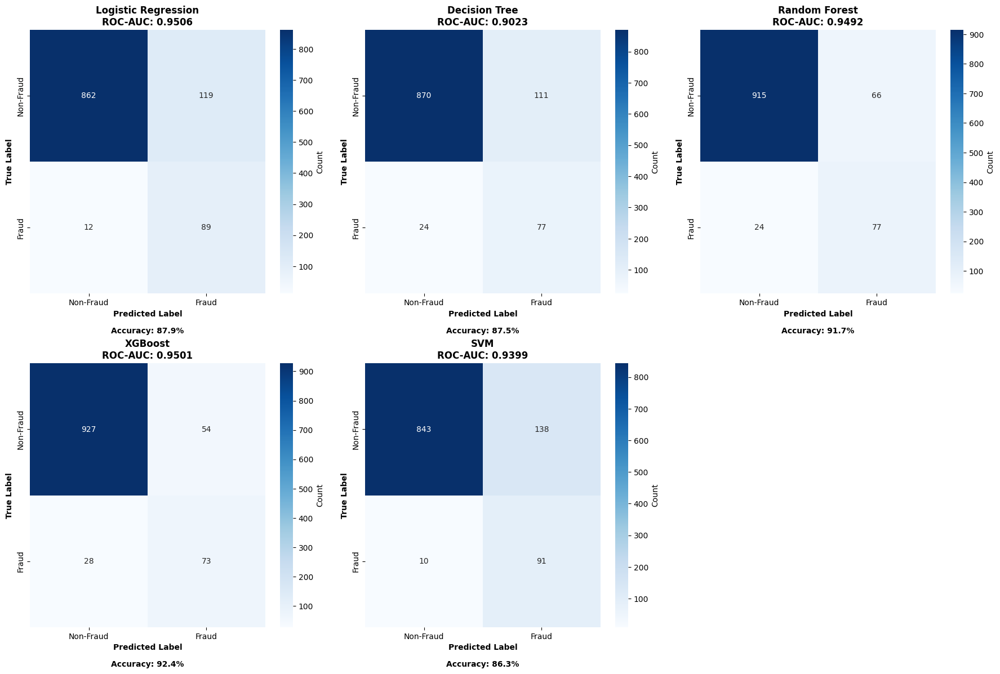
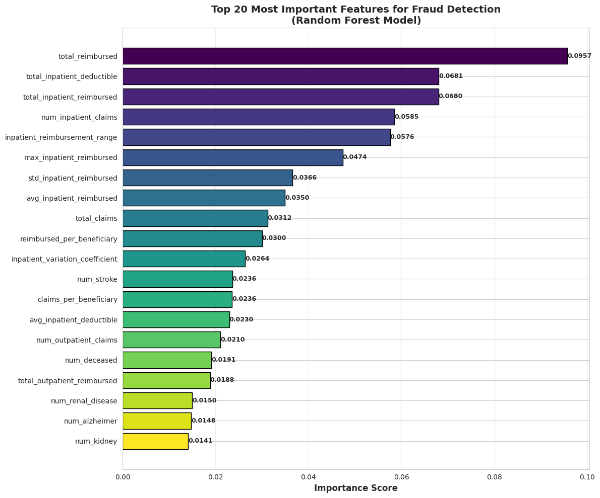

# Healthcare Provider Fraud Detection

A machine learning pipeline that flags potentially fraudulent Medicare providers from claims data, built as a course project. Three-notebook pipeline: data exploration & feature engineering → modeling → evaluation, plus a full technical report.

## Problem & data

- **Source:** [Healthcare Provider Fraud Detection](https://www.kaggle.com/datasets/rohitrox/healthcare-provider-fraud-detection-analysis) dataset (Kaggle)
- **Scale:** 138,556 patients, 558,211 claims (40,474 inpatient + 517,737 outpatient), 5,410 providers
- **Challenge:** severe class imbalance — only 506 providers (9.4%) are labeled fraudulent (≈9.7:1 ratio)
- **Prediction unit:** the *provider*, not the individual claim — all patient- and claim-level data is aggregated up to 51 provider-level features (financial aggregates, chronic-condition rates, claim-volume statistics, engineered ratios)

## Methodology

1. **`01_data_exploration_and_feature_engineering.ipynb`** — loads and cleans the four raw datasets (beneficiary, inpatient, outpatient, fraud labels), handles missing values, and aggregates everything to 51 provider-level features.
2. **`02_modeling.ipynb`** — 80/20 stratified train/test split, feature scaling, SMOTE applied to the *training set only* (test set kept at the natural 9.4% fraud rate for realistic evaluation), and five models trained: Logistic Regression, Decision Tree, Random Forest, XGBoost, SVM.
3. **`03_evaluation.ipynb`** — confusion matrices, a cost-benefit analysis, and deployment recommendations based on risk tiers.

## Results (as reported in `Technical_Report.pdf`)

| Model | ROC-AUC | Precision | Recall | F1 |
|---|---|---|---|---|
| **Logistic Regression** | **0.9506** | 0.4279 | 0.8812 | 0.5761 |
| XGBoost | 0.9501 | 0.5748 | 0.7228 | 0.6404 |
| Random Forest | 0.9492 | 0.5385 | 0.7624 | 0.6311 |
| SVM | 0.9399 | 0.3974 | 0.9010 | 0.5515 |
| Decision Tree | 0.9023 | 0.4096 | 0.7624 | 0.5329 |

Logistic Regression was selected as the best model — highest ROC-AUC, near-top recall (it catches 88.1% of fraudulent providers in the held-out test set, second only to the SVM's 90.1% at lower precision), and the most interpretable choice for a regulated healthcare context. Confusion matrix on the test set (from `notebooks/03_evaluation.ipynb`): 89 true positives, 862 true negatives, 119 false positives, 12 false negatives.

The top predictive features (Random Forest importance) were dominated by financial aggregates — `total_reimbursed`, `total_inpatient_deductible`, `total_inpatient_reimbursed`, `num_inpatient_claims`, and `inpatient_reimbursement_range` ranked highest. Deceased-patient count (`num_deceased`) is a smaller signal (rank 16 of the top 20).

The report additionally includes a cost-benefit and ROI projection (error costs, investigation-efficiency gains, and a scaled-savings estimate) based on assumed per-case investigation costs — this is a course-project business-case exercise, not a validated real-world deployment figure, and is presented in `Technical_Report.pdf` with its assumptions stated.

### Correction note

`Technical_Report.pdf` (the submitted report) lists the Logistic Regression confusion matrix as 926 true negatives / 55 false positives, and prices false positives at $275K on that basis. The notebook's computed outputs give 862 / 119 (and a $595K false-positive cost at the same $5,000 per case). The notebook numbers are the ones consistent with the reported precision (89 / (89 + 119) = 0.4279) and accuracy (0.8789), so this README uses them. The PDF is kept unmodified as the original submission.

## Skills demonstrated

End-to-end ML pipeline design on real-world-scale tabular data, correct handling of class imbalance (SMOTE on training data only, to avoid leakage into evaluation), comparative model evaluation beyond accuracy (ROC-AUC, precision/recall trade-offs appropriate for imbalanced classification), and translating model output into a business-facing report with error analysis and deployment recommendations.
